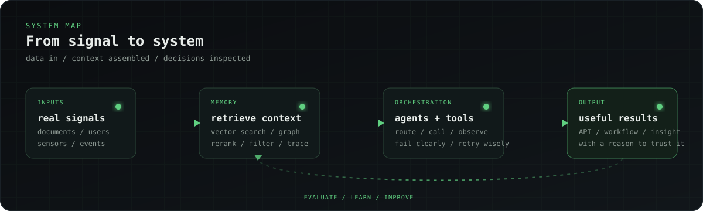

  <h1>Daniel Yamanoğlu</h1>
  
<strong>AI/ML Engineer</strong> · RAG · Agent Systems · Backend

  
Building systems that retrieve the right context, use tools, and leave useful traces when they fail.

  

    <a href="https://danielyamanoglu.github.io/">Portfolio</a>
    ·
    <a href="https://www.linkedin.com/in/daniel-yamano%C4%9Flu-75516a203/">LinkedIn</a>
    ·
    <a href="https://danielyamanoglu.github.io/Daniel_Yamanoglu_CV.pdf">Résumé</a>
    ·
    <a href="mailto:yamanogludaniel@gmail.com">Email</a>
  

<pre><code>$ whoami
daniel / AI-ML engineer

$ currently
retrieval + agent memory + Python backends

$ location
Istanbul → Remote / Global
</code></pre>

## About

I work in the awkward middle layer where a model meets a database, an API, a sensor, or a user who did not follow the happy path.

My background is in Control &amp; Automation Engineering, so I naturally care about state, signals, feedback, and failure modes. I am equally happy thinking about a Kalman filter or a FastAPI endpoint, preferably with good logs for both.

I spend a healthy amount of time asking agents two questions: **what did you retrieve, and why?**

  

<table>
  <tr>
    <td width="33%" valign="top">
      BUILDING NOW 
      <strong>Agent memory</strong> 
      Retrieval, context, traces.
    </td>
    <td width="33%" valign="top">
      THE QUESTION 
      <strong>What did you retrieve?</strong> 
      And why did you use it?
    </td>
    <td width="33%" valign="top">
      OPEN TO 
      <strong>AI/ML + backend</strong> 
      Istanbul · remote / global.
    </td>
  </tr>
</table>

> Models with evidence. APIs with useful errors. Logs that tell the truth.

## What I build

<table>
  <tr>
    <td width="50%" valign="top">
      <h3>Retrieval &amp; memory</h3>
      Embeddings, reranking, vector search, graph memory, and evaluation flows.
    </td>
    <td width="50%" valign="top">
      <h3>Agents &amp; tools</h3>
      Routing, tool calls, structured context, memory, and failure handling.
    </td>
  </tr>
  <tr>
    <td width="50%" valign="top">
      <h3>Applied ML</h3>
      XGBoost, SHAP, neural models, sensor data, and predictive workflows.
    </td>
    <td width="50%" valign="top">
      <h3>Backend systems</h3>
      Python, FastAPI, Docker, async APIs, and data-focused services.
    </td>
  </tr>
</table>

## Things I have built

| Build | The short version |
| --- | --- |
| [**Life OS**](https://github.com/DanielYamanoglu/lifeos) | A personal knowledge engine: capture pipeline, Neo4j graph + Qdrant vectors, hybrid retrieval with provenance, tool-using agents and an MCP server. |
| [**Mevzuat-RAG**](https://github.com/DanielYamanoglu/mevzuat-rag) | Evaluated RAG over Turkish banking and data-protection law: hybrid BM25 + dense retrieval (0.92 Recall@5), PII masking, prompt-injection refusal and validated citations in a LangGraph pipeline. |
| [**Credit Risk Scorecard**](https://github.com/DanielYamanoglu/credit-risk-scorecard) | Probability of default for 30,000 card accounts: WoE scorecard with points and a monotonic gradient boosting challenger (test Gini 0.54), validated with KS, calibration and PSI, plus a profit based approval cutoff. |
| [**Turbofan-RUL**](https://github.com/DanielYamanoglu/turbofan-rul) | Remaining-useful-life prediction on NASA C-MAPSS: SQL window features, gradient boosting (test RMSE 11.2 vs 20.6 baseline), PSI drift monitoring, FastAPI + Docker. |
| [**FtsDoc**](https://github.com/DanielYamanoglu/ftsdoc) | Document intelligence: a fine-tuned transformer NER plus a LangChain pipeline that turns CVs, invoices, contracts and spec sheets into typed JSON. |
| [**Predictive Maintenance Telemetry**](https://github.com/DanielYamanoglu/predictive-maintenance-telemetry) | Modbus/MQTT sensor ingestion, feature windows and anomaly/failure models on a simulated plant. |
| [**Matchfluence Matching**](https://github.com/DanielYamanoglu/matchfluence-matching) | Explainable creator-brand matching: embedding retrieval, a hybrid re-rank and a score breakdown for every match, with a pgvector/Supabase schema as reference SQL. |
| [**Employee Turnover Prediction**](https://github.com/DanielYamanoglu/employee-turnover-prediction) | XGBoost turnover-risk model with SHAP explanations and a Streamlit dashboard, re-implemented on public data. |
| [**INS/GNSS Fusion**](https://github.com/DanielYamanoglu/ins-gnss-fusion) | 3D INS/GNSS for a UAV: 15-state error-state Kalman filter with static alignment and in-flight IMU calibration, 0.64 m position and 0.1° roll/pitch error, a 60 s GNSS outage bridged at 14 m, every GNSS jump rejected by a chi-square gate, NEES-validated over 50 Monte Carlo runs. |
| [**Fixed-Wing Autopilot**](https://github.com/DanielYamanoglu/fixed-wing-autopilot) | Flight control for a small UAV: nonlinear 6 DoF model, trim and linearisation, successive loop closure PID vs LQR, stability margins at every actuator (≥ 50° phase margin), waypoint mission in wind and Dryden turbulence, 99/100 Monte Carlo runs with airframe uncertainty. |
| [**EKF + Fuzzy-CTC**](https://github.com/DanielYamanoglu/ekf-fuzzy-ctc-manipulator) | My thesis: a 2-DOF manipulator where state estimation (EKF) meets fuzzy gain scheduling and computed-torque control. MATLAB plus a Python port. |

## My usual toolbox

  <code>Python</code>
  <code>FastAPI</code>
  <code>Docker</code>
  <code>PostgreSQL</code>
  <code>Qdrant</code>
  <code>Neo4j</code>
  <code>PyTorch</code>
  <code>XGBoost</code>
  <code>Hugging Face</code>
  <code>MCP</code>
  <code>MQTT / Modbus</code>
  <code>SHAP</code>
  <code>LangChain</code>
  <code>LangGraph</code>
  <code>TypeScript</code>
  <code>C/C++</code>

## Small rules I code by

- Make the state and data flow visible.
- When retrieval is empty, return a useful signal instead of a confident guess.
- A vector database can store context; it cannot replace evaluation.
- Test the empty, stale, slow, and malformed cases too.

## Currently

Exploring agent memory, retrieval evaluation, and Python-first backends for AI products.

I am open to AI/ML Engineer, Applied AI, and Python backend roles in Istanbul or with remote teams.

If you are building systems that connect models to real data, [say hello](mailto:yamanogludaniel@gmail.com).

  Portfolio · <a href="https://danielyamanoglu.github.io/">danielyamanoglu.github.io</a>

